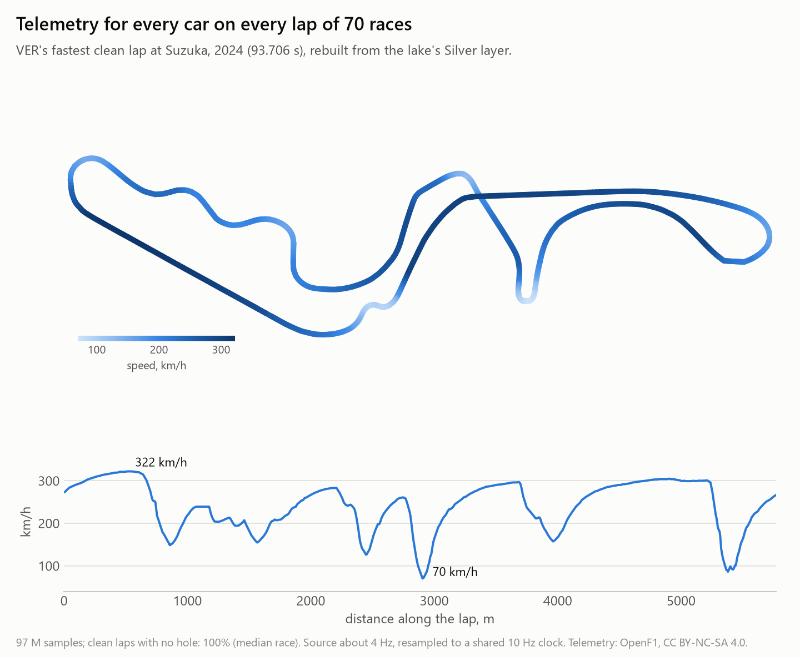
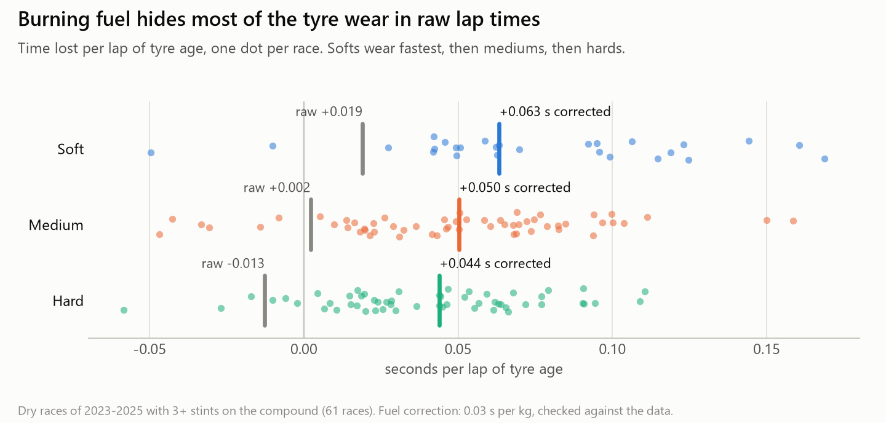
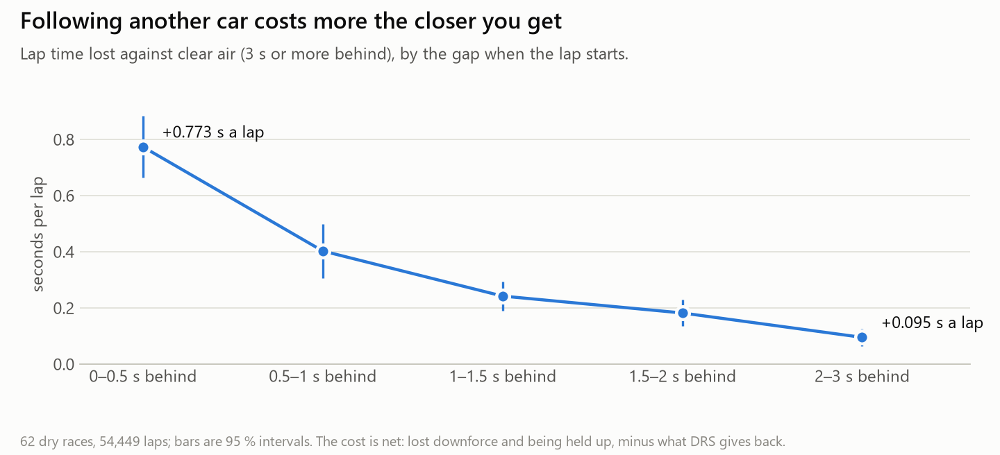
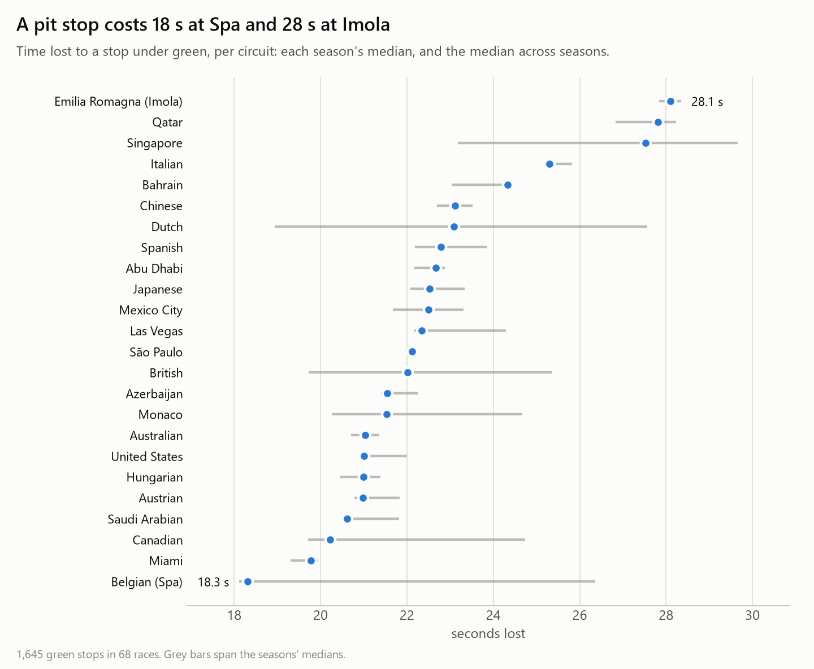
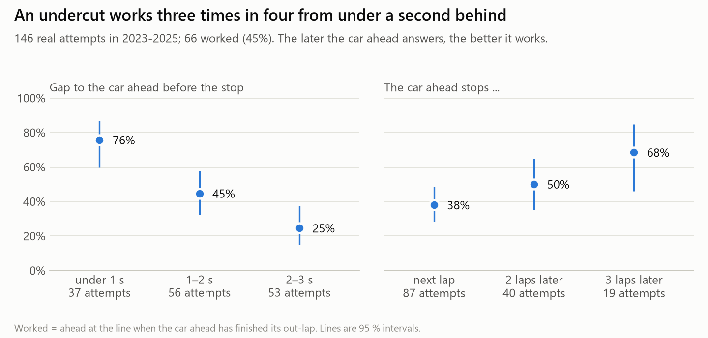
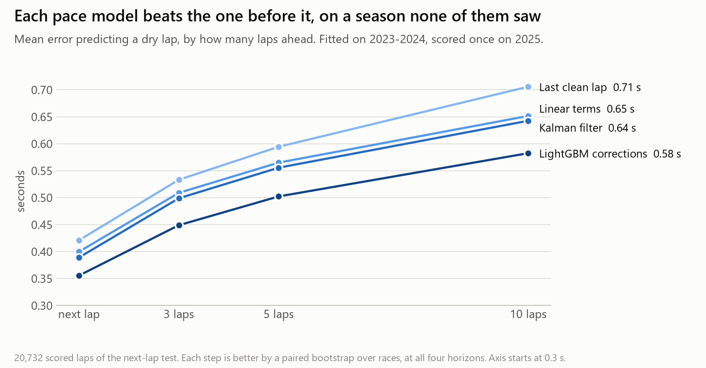
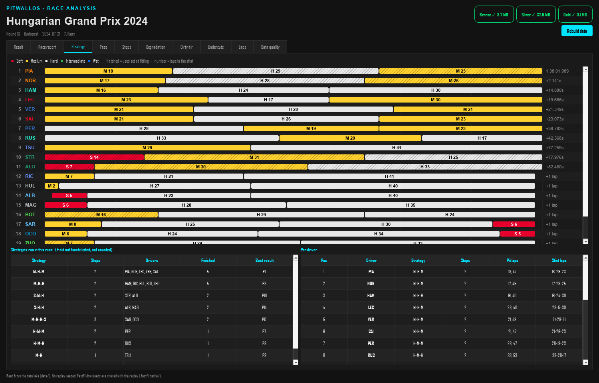
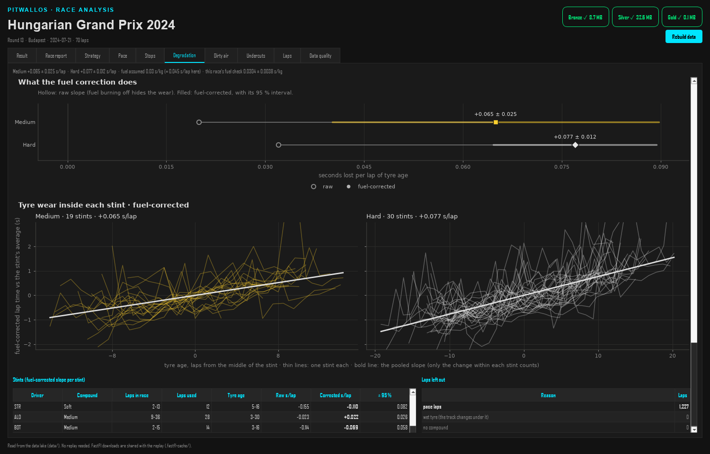

# PitwallOS 🏎️

An end-to-end Formula 1 data project: a data lake of 90 races (2023-2026) with telemetry, built from [OpenF1](https://openf1.org), an analytics engine that measures what
actually decides a race, and a ladder of pace models. Every number comes with its sample size and uncertainty, and is tested
against a known fact of a real race.

PitwallOS is built on top of **[F1 Race Replay](https://github.com/IAmTomShaw/f1-race-replay) by
[Tom Shaw](https://tomshaw.dev)**, a Python app that replays a race on a 2D track map.

<picture>
  <source media="(prefers-color-scheme: dark)" srcset="docs/images/track_speed-dark.png">
  
</picture>

## The idea everything is built around

    lap time = base pace (driver, car, track)
             + fuel effect
             + tyre effect (compound, age)
             + traffic effect (dirty air)
             + track evolution
             + noise

Each phase works on these terms. The analytics measure them from real races, the models learn them, and telemetry explains
them corner by corner. Every phase is checked by the one after it.

## What 70 races say (2023-2025)

All from 2023-2025: 77,373 laps, 65,121 of them showing true pace. Each analysis started from a written design and a predicted
number, and ended with tests on real races. The race report checks 688 numbers against ranges written down before measuring,
and none is left unexplained.

**Tyres wear more than lap times show.** A car gets lighter as it burns fuel, which hides most of the wear. Corrected for fuel, a
soft loses 0.063 s for every lap of tyre age, a medium 0.050 s and a hard 0.044 s.

<picture>
  <source media="(prefers-color-scheme: dark)" srcset="docs/images/tyre_wear-dark.png">
  
</picture>

**Following a car is expensive, and it does not stop at the famous 1.5 s.** Within half a second it costs about 0.77 s a lap, and
cars 2-3 s back still lose 0.10 s. The cost is net: lost downforce and being held up, minus what DRS gives back.

<picture>
  <source media="(prefers-color-scheme: dark)" srcset="docs/images/dirty_air-dark.png">
  
</picture>

**A pit stop's price depends on the circuit.** A stop under green costs a median of 22.2 s, from 18 s at Spa to 28 s at Imola. A
typical car stands still for 2.7 s of that.

<picture>
  <source media="(prefers-color-scheme: dark)" srcset="docs/images/pit_loss-dark.png">
  
</picture>

**An undercut is about the gap, and about how fast the rival answers.** Of 146 real attempts, 45 % worked (95 % interval 37-53 %).

<picture>
  <source media="(prefers-color-scheme: dark)" srcset="docs/images/undercuts-dark.png">
  
</picture>

## Predicting the next lap, and the ten after it

When a lap ends, how fast will the driver's next lap be? Four models, each built to beat the one before it, were developed on the
46 races of 2023-2024 (cross-validated by race, never by lap) and scored once on 2025, a season locked in the code until all
four existed.

<picture>
  <source media="(prefers-color-scheme: dark)" srcset="docs/images/pace_models-dark.png">
  
</picture>

| Model | What it predicts with | Next lap | 10 laps ahead |
|---|---|---|---|
| Persistence | the driver's last clean lap | 0.421 s | 0.706 s |
| Linear decomposition | base pace + tyre, fuel and traffic terms fitted on other races | 0.400 s | 0.652 s |
| State-space | the same, with the base pace followed by a Kalman filter | 0.389 s | 0.643 s |
| LightGBM corrections | the state-space model + boosted trees that learn its errors | **0.355 s** | **0.582 s** |

For scale: two clean laps in a row by the same driver differ by about 0.38 s on average in 2025. What is left is mostly rare big
misses (traffic, battles, restarts).

## How it is built

### The data lake

| Layer | Holds | Rules |
|---|---|---|
| **Bronze** | Raw tables, as delivered: laps, weather, track status, race control, results, F1's pit-stop record, telemetry | Never changed after download |
| **Silver** | Cleaned laps with flags (pit passage kind, stints, safety car / VSC / red flag, clean lap, wet tyre, weather); telemetry on a shared 10 Hz clock | Never invent a value; never delete a lap, flag it |
| **Gold** | One row per lap, ready for models: fuel estimate, gaps, recent pace, next-lap target | Every feature is known when the lap ends (a test enforces no leakage) |

Every table is checked against a data contract before it is written, and every dropped row is counted.

**Telemetry** covers all 90 races: 1,789 car-races and 97 million samples. Each race gets a quality report covering data holes, lap
length, speed against position and the finish line's place on the map. 74 races pass every check. The others are source faults, such as
feed outages or one car's speed sensor, and 2026 has more of them (Monaco 2026's car positions stop 45 minutes before the flag)
([guide](docs/phase5_step0_telemetry.md)).

**Where the data comes from.** Everything comes from [OpenF1](https://openf1.org), free from 2023, no login. Until October 2026 the lap
data came from FastF1, which F1's archive now refuses without a paid login. The move is documented step by step in
[docs/openf1_migration.md](docs/openf1_migration.md): the lake was rebuilt from OpenF1 beside the old one and compared race by race;
every analytics headline and every model score above was reproduced on it.

### The Analyze window

`python main.py` → pick a race → **Analyze**. Without running the replay, it shows the result, the race report, the tyre strategies and a
tab per analysis, with hover tooltips on every chart.





## Roadmap

| Phase | Work | Status |
|---|---|---|
| 0. Pipeline | Bronze / Silver / Gold, data contracts, tests | Done |
| 1. Backfill | 2023-2025, a quality report per race | Done |
| 2. Analytics | Lap selection, pit loss, fuel-corrected degradation, dirty air, undercuts, race report | Done |
| 3. Pace model | Persistence → linear decomposition → state-space → gradient boosting, on races each has never seen | Done |
| 4. Telemetry | In the lake, with a quality report; a track model of every race (reference line, shared lap distance, corners: 88 % of official corners found, 99.5 % of those taken under 150 km/h); per car, lap and corner: segment time, corner and minimum speed, entry and exit speed, braking point, throttle pick-up (a lap's segment times add up to its official lap time within 0.03 s). Next: driver comparison, tyre fade in corner speeds | In progress |
| 5. Presentation | A web front end and a written case study of one race | Planned |

## Getting started

Requires Python 3.10+ (developed on 3.11; tests run on 3.10, 3.11 and 3.12).

```bash
git clone https://github.com/Rohxn14/PitwallOS
cd PitwallOS
python -m venv venv
# Windows: .\venv\Scripts\activate      macOS / Linux: source venv/bin/activate
python -m pip install -r requirements-dev.txt
python -m pytest            # run the test suite, needs no data
python main.py              # pick a race, then Replay or Analyze
```

The lake is not in the repository: you build it from [OpenF1](https://openf1.org) (free, no login, races from 2023 on; about 3 minutes
a race with telemetry at OpenF1's free request rate).

```bash
python -m src.pipeline.runner --year 2024 --round 12                  # one race, from OpenF1
python -m src.pipeline.runner --year 2024 --round 12 --no-telemetry   # laps only
python -m src.pipeline.backfill --season 2024                         # a whole season; resumes where it stopped
python -m src.analytics.report --season 2023 2024 2025                # every analytics number, checked
python -m src.models.holdout                                          # every pace model, scored on 2025
python -m docs.make_figures                                           # this page's charts
```

## Race replay

The replay comes from F1 Race Replay (Tom Shaw and its contributors), with a few fixes (an accurate leaderboard at the end of a race,
rewind-safe insight windows).

Every race, sprint and qualifying session from 2023 on replays from the data lake (OpenF1's telemetry): 90 races so far. A session
that is not in the lake yet is downloaded first, about 3 minutes, once. Checked against FastF1 on the one race weekend both have
(Baku 2026): in the race the same car is a median 0.5 m apart in the two replays, with the same order 99.6 % of the time and the same
result; in qualifying all 47 fastest laps have the same time ([guide](docs/openf1_migration.md)).

**Current limits:** the track outline of a race is drawn from a race lap, and gaps between cars update about every 4 s. Seasons before
2023 are not available: OpenF1 starts there.

**Features**

- Watch the race unfold with live driver positions on the track map
- Leaderboard with positions, tyre compounds and retired drivers marked "OUT"
- Simulated safety car, placed ahead of the leader whenever the official feed shows one
- Pause, rewind, fast forward and playback speed controls
- Driver telemetry (speed, gear, DRS) for the selected drivers
- Insights menu with live telemetry windows, and qualifying replays (in development)


**Controls**

- **Pause / resume:** SPACE
- **Rewind / fast forward:** ← / →
- **Playback speed:** ↑ / ↓ (0.5x, 1x, 2x, 4x), or keys 1-4
- **Restart:** R · **DRS zones:** D · **Progress bar:** B · **Driver names:** L
- **Select drivers:** click, or shift-click for several

**From the command line**

```bash
python main.py --cli                                      # menu in the terminal
python main.py --viewer --year 2025 --round 12            # a race directly
python main.py --viewer --year 2025 --round 12 --sprint   # the sprint
python main.py --viewer --year 2025 --round 12 --qualifying
python main.py --viewer --year 2025 --round 12 --refresh-data   # recompute the cached replay
```

**Custom insight windows:** subclass `PitWallWindow` to build a window fed by the live telemetry stream. See
[docs/PitWallWindow.md](./docs/PitWallWindow.md), [docs/InsightsMenu.md](./docs/InsightsMenu.md) and [telemetry.md](./telemetry.md).

**Known issue:** in a `conda` environment you may see `Unable to create an OpenGL 3.3+ context`; `conda install -c conda-forge libstdcxx-ng`
fixes it (thanks to @el-mandaloriano, #12).

## Project layout

```
main.py                  entry point: session picker, then Replay or Analyze
src/pipeline/            the data lake: OpenF1 client, Bronze and translation, cleaner (Silver), feature store (Gold),
                         telemetry quality report, contracts, backfill
src/analytics/           lap selection, neutralised periods, pit stops, tyre wear, dirty air, undercuts, race report
src/models/              the evaluation harness, the four pace models, the 2025 test
src/gui/                 session picker, Analyze window and its charts, insights menu
src/interfaces/          race and qualifying replay (Arcade)
src/insights/            live telemetry windows
src/lib/                 running order, tyres, time, settings
tests/                   unit tests and golden tests on real races (fixtures in tests/fixtures/)
docs/                    developer's guides, a catalogue of F1 strategies, this page's charts
```

## Credits and data

- **[Tom Shaw](https://tomshaw.dev)** created [F1 Race Replay](https://github.com/IAmTomShaw/f1-race-replay), the replay, track map, insights menu and
  telemetry stream this project is built on. Its contributors are listed in [contributors.md](./contributors.md), and its roadmap is kept in
  [docs/upstream_roadmap.md](./docs/upstream_roadmap.md).
- **[FastF1](https://github.com/theOehrly/Fast-F1)** supplied this project's lap data until October 2026, and its table layout is still what the
  pipeline's cleaner reads. It is no longer a dependency.
- **[MultiViewer](https://multiviewer.app)** provides each circuit's map rotation and corner numbers.
- **[OpenF1](https://openf1.org)** provides all the data (laps, pit stops, Race Control, results, telemetry), under [CC BY-NC-SA 4.0](https://creativecommons.org/licenses/by-nc-sa/4.0/). The charts on this page and the
  test fixtures in `tests/fixtures/openf1/` are derived from it and shared under the same licence, for non-commercial use.

## License

The code is under the MIT License, as the original project.

## Disclaimer

Unofficial project, for education and non-commercial use. Not associated with Formula 1. Formula 1 and related trademarks are the property of their
respective owners. All data comes from publicly available sources.
