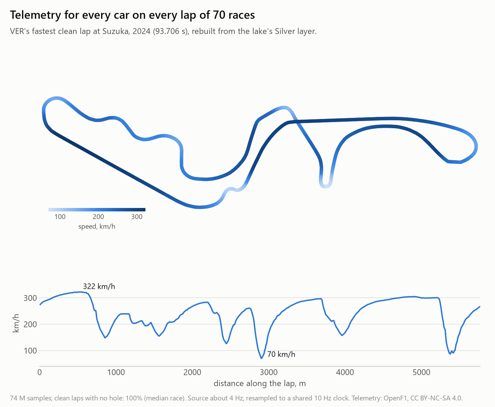
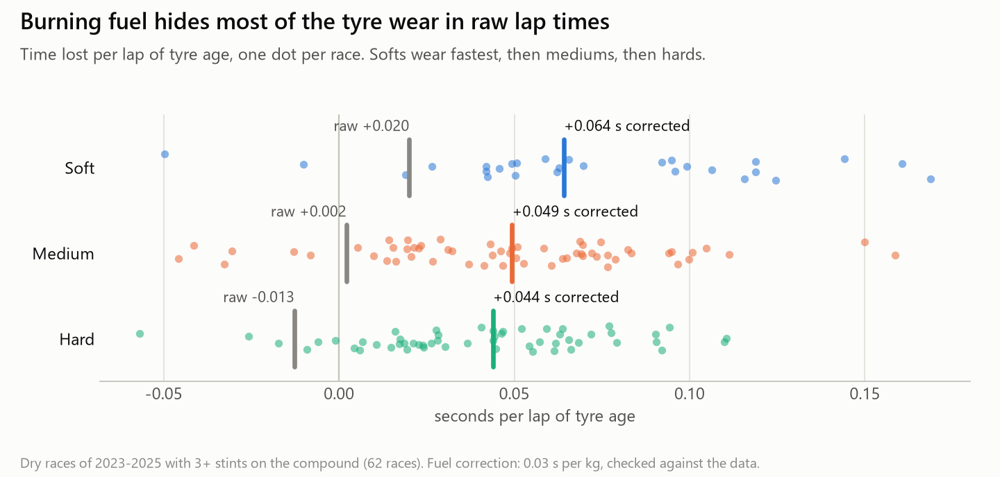
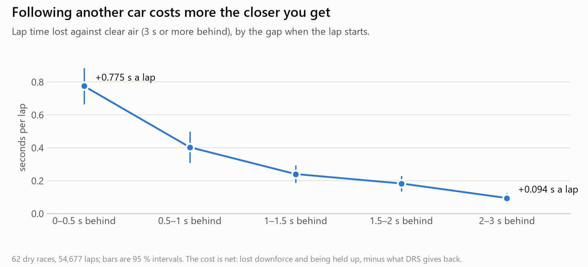
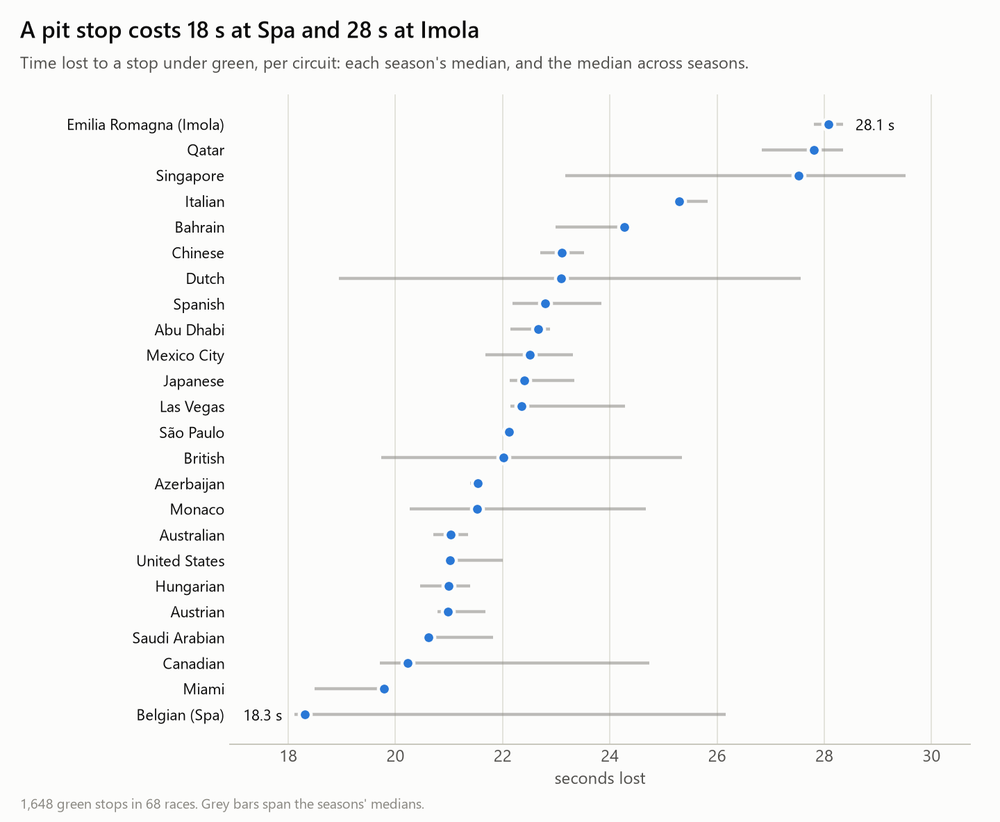
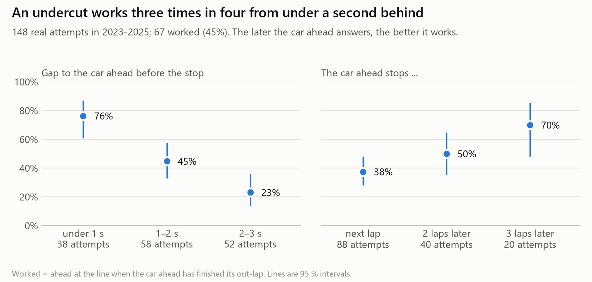
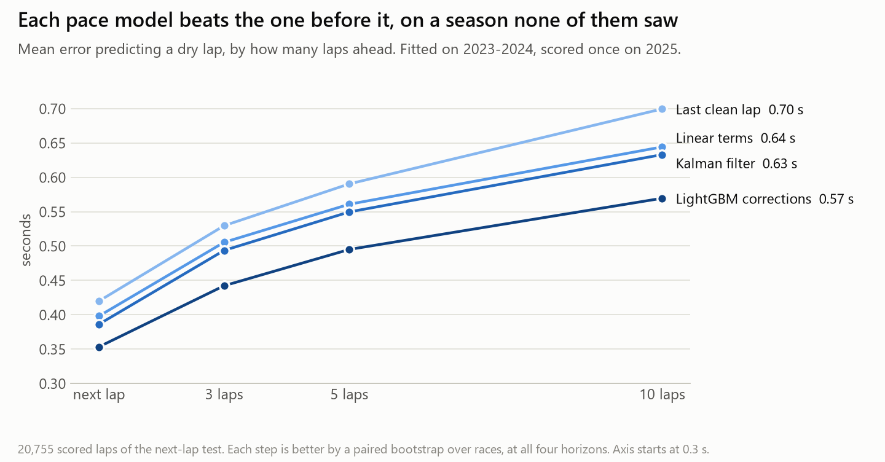
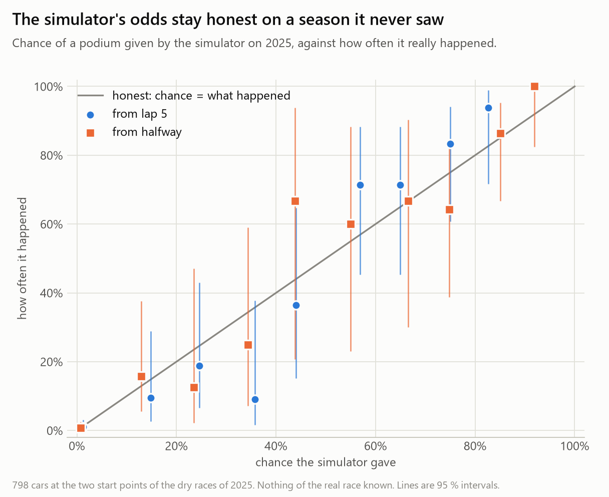
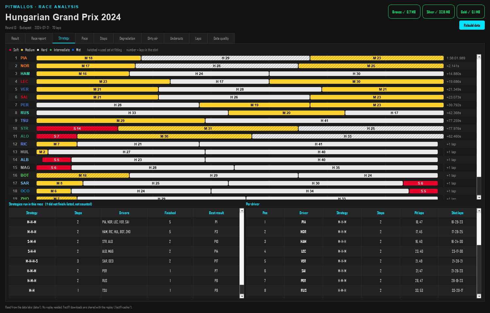
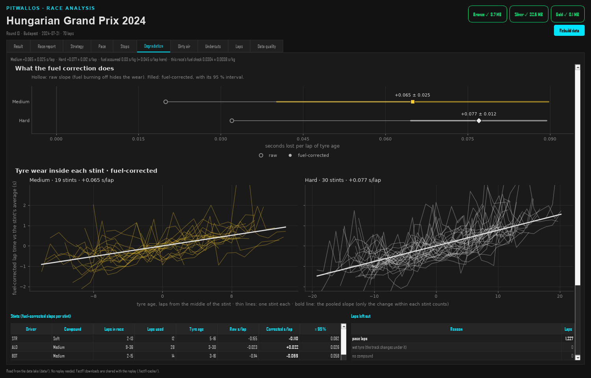

# PitwallOS 🏎️

An end-to-end Formula 1 data project: a data lake of 70 races, an analytics engine that measures what actually decides a
race, a ladder of pace models and a race simulator. Every number comes with its sample size and uncertainty, and is tested
against a known fact of a real race.

PitwallOS is built on top of **[F1 Race Replay](https://github.com/IAmTomShaw/f1-race-replay) by
[Tom Shaw](https://tomshaw.dev)**, a Python app that replays a race on a 2D track map.

<picture>
  <source media="(prefers-color-scheme: dark)" srcset="docs/images/track_speed-dark.png">
  
</picture>

## The idea everything is built around

    lap time = base pace (driver, car, track)
             + fuel effect
             + tyre effect (compound, age)
             + traffic effect (dirty air)
             + track evolution
             + noise

Each phase works on these terms. The analytics measure them from real races, the models learn them, and the simulator uses
them. Every phase is checked by the one after it.

## What 70 races say

All from 2023-2025: 77,713 laps, 65,698 of them showing true pace. Each analysis started from a written design and a predicted
number, and ended with tests on real races. The race report checks 686 numbers against ranges written down before measuring,
and none is left unexplained.

**Tyres wear more than lap times show.** A car gets lighter as it burns fuel, which hides most of the wear. Corrected for fuel, a
soft loses 0.064 s for every lap of tyre age, a medium 0.049 s and a hard 0.044 s.

<picture>
  <source media="(prefers-color-scheme: dark)" srcset="docs/images/tyre_wear-dark.png">
  
</picture>

**Following a car is expensive, and it does not stop at the famous 1.5 s.** Within half a second it costs about 0.78 s a lap, and
cars 2-3 s back still lose 0.09 s. The cost is net: lost downforce and being held up, minus what DRS gives back.

<picture>
  <source media="(prefers-color-scheme: dark)" srcset="docs/images/dirty_air-dark.png">
  
</picture>

**A pit stop's price depends on the circuit.** A stop under green costs a median of 22.5 s, from 18 s at Spa to 28 s at Imola. A
typical car stands still for 2.7 s of that.

<picture>
  <source media="(prefers-color-scheme: dark)" srcset="docs/images/pit_loss-dark.png">
  
</picture>

**An undercut is about the gap, and about how fast the rival answers.** Of 148 real attempts, 45 % worked (95 % interval 37-53 %).

<picture>
  <source media="(prefers-color-scheme: dark)" srcset="docs/images/undercuts-dark.png">
  
</picture>

## Predicting the next lap, and the ten after it

When a lap ends, how fast will the driver's next lap be? Four models, each built to beat the one before it, were developed on the
46 races of 2023-2024 (cross-validated by race, never by lap) and scored once on 2025, a season locked in the code until all
four existed.

<picture>
  <source media="(prefers-color-scheme: dark)" srcset="docs/images/pace_models-dark.png">
  
</picture>

| Model | What it predicts with | Next lap | 10 laps ahead |
|---|---|---|---|
| Persistence | the driver's last clean lap | 0.420 s | 0.700 s |
| Linear decomposition | base pace + tyre, fuel and traffic terms fitted on other races | 0.398 s | 0.644 s |
| State-space | the same, with the base pace followed by a Kalman filter | 0.386 s | 0.633 s |
| LightGBM corrections | the state-space model + boosted trees that learn its errors | **0.353 s** | **0.569 s** |

For scale: two clean laps in a row differ by 0.365 s on average, and even a guess that sees the laps on both sides of a lap misses it
by 0.26 s. What is left is mostly rare big misses (traffic, battles, restarts).

## The race simulator

The simulator replays a race from any lap on those pace models, with measured rules for passing, safety cars and pit stops, then
runs it hundreds of times with safety cars, retirements and the teams' reactions drawn at random. It answers what-if questions as
odds. A small strategy game built on it lets you make the pit calls from a team's seat ([guide](docs/phase4_simulator.md)).

Tested once on 2025, a season it never saw, the odds stayed honest, within what luck alone explains:

<picture>
  <source media="(prefers-color-scheme: dark)" srcset="docs/images/honest_odds-dark.png">
  
</picture>

The same test found its limit. From lap 5, its finishing order on 2025 was no clearer than assuming nobody moves (2.01 places off
per car against 1.94), and its odds were barely sharper than a simple history guess. Given each driver's real pace it does beat that
(1.29 places). The weak link is forecasting who is fast in a new season.

## How it is built

### The data lake

| Layer | Holds | Rules |
|---|---|---|
| **Bronze** | Raw tables, as delivered: laps, weather, track status, race control, results, F1's pit-stop record, telemetry | Never changed after download |
| **Silver** | Cleaned laps with flags (pit passage kind, stints, safety car / VSC / red flag, clean lap, wet tyre, weather); telemetry on a shared 10 Hz clock | Never invent a value; never delete a lap, flag it |
| **Gold** | One row per lap, ready for models: fuel estimate, gaps, recent pace, next-lap target | Every feature is known when the lap ends (a test enforces no leakage) |

Every table is checked against a data contract before it is written, and every dropped row is counted.

**Telemetry** covers all 70 races: 1,388 car-races and 74 million samples. Each race gets a quality report covering data holes, lap
length, speed against position and the finish line's place on the map. 63 races pass every check, and the other 7 are source faults such
as feed outages or one car's speed sensor ([guide](docs/phase5_step0_telemetry.md)).

### The Analyze window

`python main.py` → pick a race → **Analyze**. Without running the replay, it shows the result, the race report, the tyre strategies and a
tab per analysis, with hover tooltips on every chart.





## Roadmap

| Phase | Work | Status |
|---|---|---|
| 0. Pipeline | Bronze / Silver / Gold, data contracts, tests | Done |
| 1. Backfill | 2023-2025, a quality report per race | Done |
| 2. Analytics | Lap selection, pit loss, fuel-corrected degradation, dirty air, undercuts, race report | Done |
| 3. Pace model | Persistence → linear decomposition → state-space → gradient boosting, on races each has never seen | Done |
| 4. Race simulator | Replay of real races, what-ifs, Monte Carlo odds, tested on 2025 | Done |
| 5. Telemetry | In the lake, with a quality report. Next: the track model, corner-by-corner comparison, minimum-speed fade as an early sign of tyre wear | In progress |
| 6. Presentation | A web front end and a written case study of one race | Planned |

## Getting started

Requires Python 3.10+ (developed on 3.11; tests run on 3.10, 3.11 and 3.12).

```bash
git clone https://github.com/Rohxn14/PitwallOS
cd PitwallOS
python -m venv venv
# Windows: .\venv\Scripts\activate      macOS / Linux: source venv/bin/activate
python -m pip install -r requirements-dev.txt
python -m pytest            # run the test suite, needs no data
python main.py              # pick a race, then Replay, Analyze or Play
```

The lake is not in the repository: you build it. **Since October 2026 F1's timing archive needs a login.** FastF1 3.9+ can use an F1 TV
Access subscription (see [its documentation](https://docs.fastf1.dev)); without one, FastF1 still serves 2021-2022 from its mirror and anything already
in your local cache. [OpenF1](https://openf1.org)'s telemetry is free from 2023 on.

```bash
python -m src.pipeline.runner --year 2024 --round 12                  # one race: laps, then OpenF1's telemetry
python -m src.pipeline.runner --year 2024 --round 12 --no-telemetry   # laps only
python -m src.pipeline.backfill --season 2024                         # a whole season; resumes where it stopped
python -m src.analytics.report --season 2023 2024 2025                # every analytics number, checked
python -m src.models.holdout                                          # every pace model, scored on 2025
python -m docs.make_figures                                           # this page's charts
```

## Race replay

The replay comes from F1 Race Replay (Tom Shaw and its contributors), with a few fixes (an accurate leaderboard at the end of a race,
rewind-safe insight windows).

**Current limit:** it reads FastF1 directly, so since October 2026 it opens only sessions already in your local FastF1 cache, or with an F1 TV
login. For any other session it says so. Rebuilding it on the lake's own telemetry, which would bring back all 70 races, is planned.

**Features**

- Watch the race unfold with live driver positions on the track map
- Leaderboard with positions, tyre compounds and retired drivers marked "OUT"
- Simulated safety car, placed ahead of the leader whenever the official feed shows one
- Pause, rewind, fast forward and playback speed controls
- Driver telemetry (speed, gear, DRS) for the selected drivers
- Insights menu with live telemetry windows, and qualifying replays (in development)


**Controls**

- **Pause / resume:** SPACE
- **Rewind / fast forward:** ← / →
- **Playback speed:** ↑ / ↓ (0.5x, 1x, 2x, 4x), or keys 1-4
- **Restart:** R · **DRS zones:** D · **Progress bar:** B · **Driver names:** L
- **Select drivers:** click, or shift-click for several

**From the command line**

```bash
python main.py --cli                                      # menu in the terminal
python main.py --viewer --year 2025 --round 12            # a race directly
python main.py --viewer --year 2025 --round 12 --sprint   # the sprint
python main.py --viewer --year 2025 --round 12 --qualifying
python main.py --viewer --year 2025 --round 12 --refresh-data   # recompute the cached replay
```

**Custom insight windows:** subclass `PitWallWindow` to build a window fed by the live telemetry stream. See
[docs/PitWallWindow.md](./docs/PitWallWindow.md), [docs/InsightsMenu.md](./docs/InsightsMenu.md) and [telemetry.md](./telemetry.md).

**Known issue:** in a `conda` environment you may see `Unable to create an OpenGL 3.3+ context`; `conda install -c conda-forge libstdcxx-ng`
fixes it (thanks to @el-mandaloriano, #12).

## Project layout

```
main.py                  entry point: session picker, then Replay, Analyze or Play
src/pipeline/            the data lake: extractor and OpenF1 (Bronze), cleaner (Silver), feature store (Gold),
                         telemetry clock and quality report, contracts, backfill
src/analytics/           lap selection, neutralised periods, pit stops, tyre wear, dirty air, undercuts, race report
src/models/              the evaluation harness, the four pace models, the 2025 test
src/simulator/           replay engine, measured rules, what-ifs, Monte Carlo odds, the game's logic
src/gui/                 session picker, Analyze window and its charts, game window, insights menu
src/interfaces/          race and qualifying replay (Arcade)
src/insights/            live telemetry windows
src/lib/                 running order, tyres, time, settings
tests/                   unit tests and golden tests on real races (fixtures in tests/fixtures/)
docs/                    developer's guides, a catalogue of F1 strategies, this page's charts
```

## Credits and data

- **[Tom Shaw](https://tomshaw.dev)** created [F1 Race Replay](https://github.com/IAmTomShaw/f1-race-replay), the replay, track map, insights menu and
  telemetry stream this project is built on. Its contributors are listed in [contributors.md](./contributors.md), and its roadmap is kept in
  [docs/upstream_roadmap.md](./docs/upstream_roadmap.md).
- **[FastF1](https://github.com/theOehrly/Fast-F1)** makes F1's timing data accessible.
- **[OpenF1](https://openf1.org)** provides the telemetry, under [CC BY-NC-SA 4.0](https://creativecommons.org/licenses/by-nc-sa/4.0/). The charts on this page and the
  test fixtures in `tests/fixtures/openf1/` are derived from it and shared under the same licence, for non-commercial use.

## License

The code is under the MIT License, as the original project.

## Disclaimer

Unofficial project, for education and non-commercial use. Not associated with Formula 1. Formula 1 and related trademarks are the property of their
respective owners. All data comes from publicly available sources.
