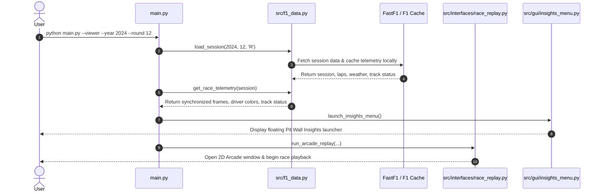

# F1 Race Replay — Master Technical & Architecture Blueprint

An in-depth, end-to-end technical guide for **F1 Race Replay**. This document details the entire architecture, data pipeline, telemetry extraction engine, 2D Arcade visualizer, PySide6 Pit Wall Insights suite, file structure, algorithms, and Machine Learning extension points as if rebuilding the project from scratch.

---

## 1. System Overview & Core Philosophy

**F1 Race Replay** is a Python-based desktop telemetry visualizer and strategy analysis tool for Formula 1. It bridges real-time telemetry extraction (via [FastF1](https://github.com/theOehrly/FastF1)) with a high-performance 2D hardware-accelerated rendering engine ([Arcade](https://arcade.academy/)) and an interactive telemetry dashboard ([PySide6](https://doc.qt.io/qtforpython-6/)).

```mermaid
flowchart TD
    subgraph Data Layer ["Data & Telemetry Engine (src/f1_data.py)"]
        FF1["FastF1 API / Cache"] --> Sync["Session Loader & Track Aligner"]
        Sync --> TrackRot["Track Rotation Engine"]
        Sync --> FrameGen["Lap-by-Lap Frame Generator"]
    end

    subgraph Launch Layer ["Application Launch (main.py)"]
        CLI["Questionary / Rich CLI"] --> Dispatcher
        GUI["PySide6 Race Selector Window"] --> Dispatcher
        Dispatcher["Main Dispatcher"]
    end

    Data Layer --> Launch Layer

    subgraph Execution Layer ["Runtime Engines"]
        Dispatcher --> Arcade["Arcade 2D Replay Engine (src/interfaces/race_replay.py)"]
        Dispatcher --> Insights["PySide6 Pit Wall Insights Menu (src/gui/insights_menu.py)"]
        Dispatcher --> Quali["Qualifying Engine (src/interfaces/qualifying.py)"]
    end

    subgraph Insights Suite ["Pit Wall Insights Windows (src/insights/)"]
        Insights --> Laps["Lap Time Chart Window"]
        Insights --> Driver["Side-by-Side Driver Telemetry"]
        Insights --> Tyre["Tyre Strategy & Stint Gantt"]
        Insights --> TrackPos["Position Change Bump Chart"]
        Insights --> Feed["Race Control Feed"]
        Insights --> Stream["Live Telemetry Stream Table"]
        Insights --> BayTyre["Bayesian Tyre Degradation Model"]
    end
```

---

## 2. Deep-Dive Directory Sitemap & Module Breakdown

| Directory / File | Lines / Purpose | Key Responsibilities |
| :--- | :--- | :--- |
| **`main.py`** | ~165 lines | Application entry point. Parses CLI flags (`--viewer`, `--cli`, `--year`, `--round`, `--sprint`, `--qualifying`), launches PySide6 GUI or CLI, and invokes `main()` session replay dispatcher. |
| **`src/f1_data.py`** | ~1,500+ lines | **Core Data Pipeline**: Session fetching, FastF1 cache management, track coordinate rotation, per-frame interpolation ($X, Y, Speed, DRS, Gear, Throttle, Brake$), driver color mapping, and race control message parsing. |
| **`src/run_session.py`** | ~80 lines | Session orchestrator that fires up the Arcade rendering window and launches the background Pit Wall insights thread. |
| **`src/bayesian_tyre_model.py`** | ~600+ lines | **Statistical / ML Core**: MCMC & PyMC / Scipy-based Bayesian model fitting stint lap times to model compound degradation, thermal degradation rate $\alpha$, and predicting optimal pit stop windows. |
| **`src/tyre_degradation_integration.py`** | ~150 lines | Connects statistical tyre degradation estimates to UI visualization cards and charts. |
| **`src/ui_components.py`** | ~2,500+ lines | **Custom UI Controls**: Replay HUD controls, interactive control buttons, speed sliders, leaderboards, track status banners, and telemetry gauge widgets. |
| **`src/cli/race_selection.py`** | ~80 lines | Terminal-based interactive menu powered by `questionary` and `rich` for selecting season, round, and session type without a GUI. |
| **`src/gui/race_selection.py`** | ~350 lines | PySide6 GUI application for browsing F1 seasons, selecting rounds with circuit thumbnails, and choosing session types (Race, Qualifying, Sprint). |
| **`src/gui/insights_menu.py`** | ~300 lines | Floating launcher panel allowing users to open/close individual telemetry insight windows independently during replay. |
| **`src/gui/settings_dialog.py`** | ~180 lines | User settings editor (cache directory, default season, UI theme, playback default speed). |
| **`src/interfaces/race_replay.py`** | ~2,200+ lines | **Arcade 2D Replay Window**: Main visual canvas rendering cars moving along track coordinates, DRS zones, sector timing, camera pan/zoom, scrubbing timeline, and live telemetry overlay. |
| **`src/interfaces/qualifying.py`** | ~1,200+ lines | Specialized qualifying replay visualizer showing Q1/Q2/Q3 knockout cutoffs, out-laps vs push-laps, and delta bars versus the pole position lap. |
| **`src/insights/`** | 7 files | PySide6 standalone analytical windows (Lap time evolution, Driver comparison, Tyre strategy Gantt, Position bump chart, Race control feed, Telemetry stream table). |
| **`src/lib/`** | 4 files | Utility helpers (`time.py` for lap formatting `1:24.312`, `tyres.py` for compound colors, `settings.py` for JSON config persistence, `season.py` for current year detection). |
| **`src/services/stream.py`** | ~160 lines | Event emitter / streaming wrapper notifying sub-windows of lap changes and frame tick events. |

---

## 3. Data Pipeline & Mathematical Transformations

### 3.1 Track Rotation & Normalization (`get_circuit_rotation`)
Raw GPS coordinates from F1 timing systems vary in orientation and aspect ratio depending on circuit geography. To fit tracks properly inside a standard 16:9 2D Arcade canvas, `src/f1_data.py` applies a 2D affine rotation matrix:

$$\begin{bmatrix} X' \\ Y' \end{bmatrix} = \begin{bmatrix} \cos\theta & -\sin\theta \\ \sin\theta & \cos\theta \end{bmatrix} \begin{bmatrix} X - X_{\text{center}} \\ Y - Y_{\text{center}} \end{bmatrix}$$

Where:
- $\theta$ is the optimal track rotation angle computed from the circuit's main straight.
- $(X_{\text{center}}, Y_{\text{center}})$ centers the track at $(0,0)$ before scaling to canvas bounds.

### 3.2 Sub-Second Frame Synchronization
FastF1 telemetry records telemetry channels ($Speed, RPM, nGear, Throttle, Brake, DRS, Position$) at ~10 Hz (every 100ms). `src/f1_data.py` aligns all 20 drivers onto a unified time grid $t_0, t_1, \dots, t_N$, interpolating spatial coordinates $(X(t), Y(t))$ so cars move smoothly along the track without jitter.

---

## 4. Key Features & How Every Tool Works

### 🏎️ 1. Hardware-Accelerated 2D Race Replay (`src/interfaces/race_replay.py`)
- **Real-Time GPS Tracking**: 20 driver dots rendered with official team colors (e.g. Red Bull Navy, Ferrari Red, Mercedes Silver/Cyan).
- **Speed Heatmap Overlay**: Option to color the track line dynamically based on car speed ($0 - 350\text{ km/h}$).
- **DRS Zone Visualizer**: Displays DRS detection lines and activation zones derived from qualifying reference telemetry.
- **Playback Control Deck**:
  - **Speed Multiplier**: $0.5\times, 1\times, 2\times, 5\times, 10\times, 20\times$.
  - **Scrubber Bar**: Jump to any lap instantly.
  - **Driver Focus Mode**: Click any car to lock camera tracking onto that driver.

### ⏱️ 2. Qualifying & Sprint Qualifying Replay (`src/interfaces/qualifying.py`)
- **Delta Comparison**: Compares every driver's push lap in real-time against the provisional pole lap.
- **Knockout Threshold Lines**: Displays Q1 (P16–P20 eliminated) and Q2 (P11–P15 eliminated) cutoffs.
- **Sector Mini-Sectors**: Displays purple (best session), green (personal best), and yellow (no improvement) sector badges.

### 📊 3. Pit Wall Insights Suite (`src/insights/`)

#### A. Lap Time Chart Window (`lap_time_chart_window.py`)
- Plots lap time progression across the race for selected drivers.
- Highlights pit stops with tire compound markers (`S` = Soft, `M` = Medium, `H` = Hard, `I` = Inter, `W` = Wet).
- Filters out Safety Car / VSC outlier laps for clean pace analysis.

#### B. Driver Telemetry Comparison (`driver_telemetry_window.py`)
- Side-by-side telemetry trace comparison between any two drivers (e.g. Hamilton vs Verstappen):
  - Speed ($\text{km/h}$)
  - Throttle ($\%$)
  - Brake ($\%$)
  - Gear ($1 - 8$)
  - DRS state ($0 = \text{Off}, 1 = \text{Available}, 10 - 14 = \text{Active}$)

#### C. Tyre Strategy & Stint Window (`tyre_strategy_window.py`)
- Horizontal Gantt chart showing stint lengths, compound choices, and tire age for every driver on the grid.

#### D. Position Change Bump Chart (`track_position_window.py`)
- Visualizes position gains and losses ($P1 \to P20$) across every lap of the Grand Prix, illustrating overtakes and pit stop falls/gains.

#### E. Race Control Message Feed (`race_control_feed_window.py`)
- Real-time log of official FIA messages:
  - Safety Car Deployed / Ending
  - Virtual Safety Car (VSC)
  - Yellow / Red Flags
  - Track Limits Investigations & Penalties

#### F. Bayesian Tyre Degradation Model (`src/bayesian_tyre_model.py`)
- Calculates statistical tire wear rate per lap $\frac{d(\text{LapTime})}{d(\text{TyreAge})}$ and outputs predicted lap time degradation curves and optimal pit windows.

---

## 5. Step-by-Step Execution Flow

When a user runs `python main.py --viewer --year 2024 --round 12`:



---

## 6. How to Extend: Machine Learning Portfolio Roadmap

To transform this setup into a world-class Data Science / ML portfolio project, you can plug custom machine learning models directly into `src/ml/`:

```
src/
└── ml/
    ├── __init__.py
    ├── feature_engineering.py    # Extracts stint, pace delta, track temp, fuel burn features
    ├── tire_degradation_model.py # XGBoost / Ridge Regressor for lap-time forecasting
    ├── pit_strategy_model.py     # Classification model for Undercut / Overcut success
    └── live_overlay.py           # Embeds ML predictions directly into Arcade HUD
```

### Proposed Portfolio Models:

1. **Tire Degradation Forecaster (`src/ml/tire_degradation_model.py`)**:
   - **Target**: Next 5 lap times given current compound, stint age, track temp, and fuel load.
   - **Algorithm**: XGBoost / LightGBM Regressor trained on FastF1 historical races ($2018 - 2024$).

2. **Real-time Undercut Win Probability (`src/ml/pit_strategy_model.py`)**:
   - **Target**: Probability ($0 - 100\%$) that pitting on lap $N$ results in track position ahead of rival.
   - **Algorithm**: Logistic Regression / Random Forest Classifier based on gap ahead, pit loss time, and fresh tire pace advantage.

3. **Safety Car / VSC Probability Estimator**:
   - Predicts likelihood of a Safety Car deployment in the next 3 laps based on sector yellow flag history and track incidents.
